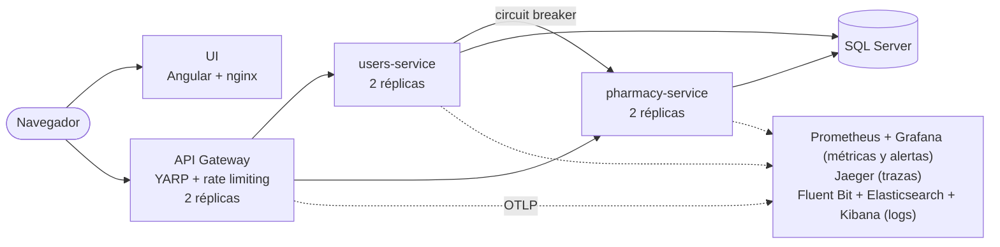

# PharmaGo sobre Kubernetes

PharmaGo es un sistema de gestión de farmacias: backend .NET 6 en microservicios, UI en Angular 14
y SQL Server. Este repo lo corre en Kubernetes (minikube, un nodo) y le agrega alta disponibilidad,
despliegues sin corte, telemetría (métricas, trazas y logs), alertas, scripts de caos, detección de
anomalías y un plan de contención de incidentes.



---

## 1. Requisitos

- **Docker Desktop.** En Windows, WSL2 tiene que darle a Docker **más de 8 GB**: poner
  `memory=10GB` en `%USERPROFILE%\.wslconfig`, correr `wsl --shutdown` y reabrir Docker Desktop.
- **minikube** y **kubectl** (sirve el de Docker Desktop o el que se instala con minikube).
- **En Windows, Git Bash.** Los `.sh` se corren con `bash script.sh` (en git no tienen permiso de
  ejecución). Los `.ps1` no son equivalentes: `apply-k8s.ps1` no despliega Fluent Bit ni Jaeger.
- **Puertos locales libres:** 4200, 5000, 5001, 5002, 11433, 9090, 3000, 5601, 9200 y 16686.
- **Recursos:** el cluster se crea con 4 CPU y 8192 MB. Con menos, algunos pods quedan en `Pending`.

## 2. Levantarlo

Desde `Implementacion K8S/Codigo/k8s/`, con Docker Desktop abierto:

```bash
minikube start --driver=docker --memory=8192 --cpus=4
bash build-images.sh        # construye las imágenes y las carga en el nodo (no hay registry)
bash apply-k8s.sh           # despliega todo en el namespace pharmago
kubectl wait --for=condition=Ready pods --all -n pharmago --timeout=600s
```

En **otra terminal**, que tiene que quedar abierta:

```bash
bash port-forward.sh        # o port-forward-watch.sh, que relanza cada forward si su pod muere
```

Usar uno de los dos, no ambos: pelean por los mismos puertos. Para el caos conviene
`port-forward-watch.sh`, porque borrar o reemplazar un pod corta el forward atado a él.

**Cargar los datos de prueba** (una sola vez), desde `Implementacion K8S/Codigo/`:

```bash
DB_POD=$(kubectl get pod -n pharmago -l app=pharmago-db -o jsonpath='{.items[0].metadata.name}')
kubectl exec -i -n pharmago "$DB_POD" -- bash -c 'cat > /tmp/seed-data.sql' < Backend/seed-data.sql
kubectl exec -n pharmago "$DB_POD" -- bash -c 'exec /opt/mssql-tools18/bin/sqlcmd -S localhost -U sa -P "$SA_PASSWORD" -C -i /tmp/seed-data.sql'
```

Termina con `Datos iniciales insertados correctamente.`. Las formas `bash -c 'cat > ...'` y
`bash -c 'exec ...'` evitan que Git Bash convierta las rutas del contenedor en rutas de Windows. En
un comando propio, lo mismo se logra con `MSYS_NO_PATHCONV=1` adelante.

## 3. Qué abrir

| Para | URL | Credenciales |
|---|---|---|
| La app | http://127.0.0.1:4200 | `admin`, `owner001` o `empleado01`, con contraseña `Abcdef12.` |
| API Gateway | http://127.0.0.1:5000 | — |
| Grafana (dashboards Overview, Infra y War room; alertas) | http://127.0.0.1:3000 | `admin` / `admin` |
| Prometheus | http://127.0.0.1:9090 | — |
| Jaeger (trazas) | http://127.0.0.1:16686 | — |
| Kibana (logs) | http://127.0.0.1:5601 | — |
| Elasticsearch | http://127.0.0.1:9200 | — |

Usar `127.0.0.1`, no `localhost`: en Windows, `localhost` no siempre llega al port-forward.

**Kibana, la primera vez:** ☰ → Stack Management → Data Views → Create data view, con
nombre `pharmago-logs`, index pattern `pharmago-logs-*` y timestamp `@timestamp`. Si no hay
índices, esperar 2 o 3 minutos a que Fluent Bit mande los primeros logs.

## 4. Parar y retomar

```bash
bash port-forward.sh --stop     # desde k8s/ (o port-forward-watch.sh --stop)
minikube stop
# otro día, con Docker Desktop abierto:
minikube start
kubectl wait --for=condition=Ready pods --all -n pharmago --timeout=600s
bash port-forward.sh
```

Se conservan la base de datos, los logs y el data view de Kibana, las métricas y los dashboards.
**Se pierden las trazas de Jaeger** (están en memoria). `minikube delete` borra todo, incluidas
las imágenes.

**Después de cambiar código:** borrar `Backend/**/bin` y `Backend/**/obj` (no hay `.dockerignore`),
`bash build-images.sh` y `kubectl rollout restart deployment/<nombre> -n pharmago`.

## 5. Ver cada mecanismo funcionando

Con el sistema levantado y el seed cargado. Los scripts de caos están en
`Implementacion K8S/Codigo/chaos-engineering/`. Conviene correr **una prueba por vez** y mirar el
dashboard **War room** con `kubectl get pods -n pharmago -w` en otra terminal.

| Mecanismo | Ítem de la rúbrica | Cómo | Qué se ve |
|---|---|---|---|
| Logs y trazas correlacionados | Telemetría | Un login: `curl -X POST http://127.0.0.1:5000/api/login -H "Content-Type: application/json" -H "X-Correlation-ID: prueba-1" -d '{"userName":"admin","password":"Abcdef12."}'` | En Kibana, `Message : "prueba-1"`. El `Scopes.TraceId` del log abre la traza en `http://127.0.0.1:16686/trace/<TraceId>` |
| Rate limiting | Alta disponibilidad | `bash load-requests.sh 100` | 10 respuestas 404 y 90 respuestas 429 (límite de 10 logins por minuto por IP y por réplica). Alerta "Rechazos elevados por rate limiting" |
| Autocuración con 2 réplicas | Alta disponibilidad | Borrar un pod de users mientras se consulta `http://127.0.0.1:5000/api/roles/ping` | Solo 200. El pod nuevo vuelve a `1/1` en segundos |
| Circuit breaker | Alta disponibilidad | `bash circuit-breaker.sh` | El circuito pasa de `closed` a `open` (503 en milisegundos) y vuelve a `closed`. Termina con `PASS`. Deja su salida en `evidencias/autorrecuperacion/` |
| Despliegue sin corte | Despliegues seguros | `kubectl rollout restart` del gateway, con un loop de `curl` dentro del cluster | Solo 200. Ver [docs/despliegue-seguro.md](docs/despliegue-seguro.md) |
| Caos: CPU, memoria, storage, red y desconexión de componentes | Scripts de caos | Ver los README de `chaos-engineering/` | Cada script dice qué alerta y qué panel mueve |

Los scripts de caos, con su uso y su limpieza, están en
[`chaos-engineering/README.md`](Implementacion%20K8S/Codigo/chaos-engineering/README.md). Los que
disparan una alerta cada uno están en
[`chaos-engineering/alertas/README.md`](Implementacion%20K8S/Codigo/chaos-engineering/alertas/README.md).
**`cpu-spike.sh` no limpia:** después hay que borrar el pod.

## 6. Problemas comunes

| Síntoma | Causa | Solución |
|---|---|---|
| `minikube start` dice que Docker tiene menos memoria que la pedida | `.wslconfig` limita la memoria de WSL2 | Ver la sección 1 |
| Pods en `Pending` con "didn't match Pod's node affinity" | El nodo no tiene `node-type=all` | `kubectl label nodes minikube node-type=all --overwrite` |
| Pods en `Pending` con "Insufficient cpu" o "Insufficient memory" | El cluster tiene menos de 4 CPU u 8 GB | `minikube delete` y crearlo de nuevo con los valores de la sección 2. Borra los datos |
| `ErrImageNeverPull` | La imagen no está en el nodo | `bash build-images.sh` |
| `docker build` falla después de compilar localmente | Se copian `bin/` y `obj/` de Windows | Borrarlos y volver a construir |
| La home sin medicamentos, o "The user does not exist" | No se cargó el seed | Sección 2 |
| El seed falla con "Invalid object name 'Roles'" | users todavía no corrió las migraciones | Esperar a que todos los pods estén `Ready` y repetir |
| El login responde 429 | Se pasó el límite de 10 por minuto | Esperar un minuto |
| "address already in use" | Quedaron forwards viejos | `bash port-forward.sh --stop`. Para Elasticsearch: `ES_LOCAL_PORT=19200 bash port-forward.sh` |
| Un forward deja de responder ("lost connection to pod") | Su pod murió (caos o rollout) | Relanzarlo, o usar `port-forward-watch.sh` |
| Un cambio de dashboard o alerta no aparece | Grafana no relee los ConfigMaps | `kubectl rollout restart deployment/grafana -n pharmago` |
| Kibana sin logs o Jaeger sin servicios | Se desplegó con `apply-k8s.ps1` | Desplegar con `bash apply-k8s.sh` |

## 7. Documentación

| Archivo | Contenido |
|---|---|
| [docs/plan-contencion.md](docs/plan-contencion.md) | Plan de contención: severidades, roles, índice alerta → runbook y runbooks |
| [docs/despliegue-seguro.md](docs/despliegue-seguro.md) | La técnica de despliegue sin corte, su evidencia y sus limitaciones |
| [evidencias/](evidencias/) | Evidencias por tema (CSV, TXT y capturas) |
| [notebook-deteccion-anomalias/](notebook-deteccion-anomalias/) | IsolationForest y One-Class SVM (núcleo RBF) |
| [evidencias/diseño-nodos/diseño.md](evidencias/diseño-nodos/diseño.md) | Diseño de nodos y diagramas de despliegue |
| [Implementacion K8S/Codigo/k8s/](Implementacion%20K8S/Codigo/k8s/) | Manifiestos y scripts de despliegue |

`Implementacion K8S/Codigo/docker-compose.yml` es el flujo anterior a Kubernetes: quedó como
legacy y no se mantiene.
