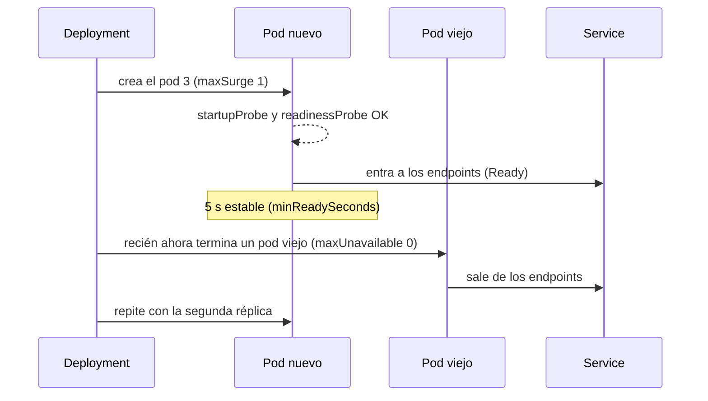

# Despliegue seguro — PharmaGo

Técnica para reemplazar los componentes de PharmaGo (una versión nueva, un reinicio, un cambio de
configuración) sin cortar el servicio.

## 1. Técnica elegida: RollingUpdate sin indisponibilidad

Los tres servicios de la aplicación (`pharmago-api-gateway`, `pharmago-users-service` y
`pharmago-pharmacy-service`) se despliegan con la estrategia `RollingUpdate` de Kubernetes,
configurada para que nunca haya menos réplicas atendiendo que las pedidas
(`k8s/deployments/backend/*.yaml`):

```yaml
spec:
  replicas: 2
  minReadySeconds: 5
  strategy:
    type: RollingUpdate
    rollingUpdate:
      maxUnavailable: 0
      maxSurge: 1
```

**Por qué esta técnica:** RollingUpdate viene con Kubernetes y alcanza para la garantía que pide el
sistema. Se descartaron:
- **blue/green**, porque necesita el doble de réplicas y otro Service (o cambiar el selector) para
  pasar el tráfico de golpe;
- **canary**, porque para repartir un porcentaje del tráfico necesita un service mesh o un ingress
  con pesos, que el cluster no tiene.

## 2. Cómo garantiza la disponibilidad

| Parámetro | Valor | Efecto |
|---|---|---|
| `replicas` | 2 | Siempre hay una réplica que atiende mientras se reemplaza la otra |
| `maxUnavailable` | 0 | No se baja un pod viejo hasta que haya uno nuevo disponible |
| `maxSurge` | 1 | Durante el rollout puede haber un pod de más (3 en total) |
| `minReadySeconds` | 5 | Un pod nuevo cuenta como disponible recién 5 s después de estar `Ready` |
| `readinessProbe` | `/health` cada 2 s, timeout 1 s, 1 falla | Un pod entra al Service solo cuando responde, y sale ante la primera falla |
| `startupProbe` | `/health` cada 2 s desde los 5 s, hasta 60 fallas | Le da al pod hasta ~125 s para arrancar antes de que actúen las otras probes |
| `livenessProbe` | `/health` cada 5 s, 3 fallas | Reinicia un contenedor que dejó de responder |

La secuencia de un rollout con 2 réplicas:



En todo momento hay al menos 2 pods `Ready` en el Service. El tráfico del gateway hacia users y
pharmacy pasa por sus Services (`http://pharmago-users-service:80` y
`http://pharmago-pharmacy-service:80` en `PharmaGo.ApiGateway/appsettings.json`), así que el
reemplazo es igual de transparente entre servicios que para el cliente.

## 3. Alcance

| Componente | Réplicas | Estrategia | Reemplazo sin corte |
|---|---|---|---|
| api-gateway, users-service, pharmacy-service | 2 | RollingUpdate, `maxUnavailable: 0` | Sí |
| ui | 1 | RollingUpdate por defecto (25 %/25 %: con 1 réplica, surge 1 y unavailable 0) | Sí, en teoría (sin medir) |
| db (SQL Server), elasticsearch, kibana, prometheus, infra-collector | 1 | `Recreate` | No: un solo pod que escribe en su volumen; se baja antes de crear el nuevo |
| grafana, otlp-collector, kube-state-metrics, jaeger | 1 | RollingUpdate por defecto | Sin medir |

La garantía de 100 % de disponibilidad aplica a los componentes de la aplicación. Los stateful
(la DB y el stack de observabilidad) tienen una sola réplica y se reemplazan con corte.

## 4. Evidencia

En `evidencias/despliegues/`, del 2026-11-10, sobre el gateway. Se consultó el gateway cada ~2 s
y se registró el código HTTP y el header `X-App-Version` de la respuesta.

| Archivo | Cambio | Respuestas | Errores | Transición |
|---|---|---|---|---|
| `gateway-v1-a-v2.csv` | v1 → v2 | 90 | 0 (todas 200) | Rollout iniciado a las 01:14:53. Primera respuesta v2 a las 01:15:01, versiones mezcladas hasta 01:15:07 y después solo v2 |
| `gateway-v2-a-v1.csv` | v2 → v1 (rollback) | 90 | 0 (todas 200) | Rollback iniciado a las 01:23:04. Primera respuesta v1 a las 01:23:13, última v2 a las 01:23:17 |

La hora de inicio de cada cambio está en `gateway-v2-inicio.txt` y `gateway-rollback-inicio.txt`.
En la v1 la respuesta no traía el header, por eso aparece como `sin-header`.

Se repitió el 2026-11-14 con un `kubectl rollout restart` del gateway: 89 de 89 respuestas 200 y
un rollout de ~30 s (sin archivo en `evidencias/`).

## 5. Cómo reproducirlo

Desde `Implementacion K8S/Codigo/k8s/`, con el sistema levantado. El loop tiene que correr
**dentro del cluster**: un port-forward se ata a un pod, y ese pod se reemplaza durante el rollout.

**Terminal 1**, un pod temporal que consulta el gateway 90 veces:
```bash
kubectl run curl-loop -n pharmago --rm -i --restart=Never --image=curlimages/curl -- \
  sh -c 'for i in $(seq 90); do curl -s -o /dev/null -w "%{http_code} " http://pharmago-api-gateway/health; sleep 1; done'
```

**Terminal 2:**
```bash
kubectl rollout restart deployment/pharmago-api-gateway -n pharmago
kubectl rollout status deployment/pharmago-api-gateway -n pharmago
```

En la terminal 1 solo tiene que haber `200`.

**Con una versión nueva:**
1. Construir la imagen con otro tag y cargarla en el nodo:
   ```bash
   docker build -f PharmaGo.ApiGateway/Dockerfile -t pharmago-api-gateway:<tag> .   # desde Backend/
   minikube image load pharmago-api-gateway:<tag>
   ```
2. Desplegarla:
   ```bash
   kubectl set image deployment/pharmago-api-gateway pharmago-api-gateway=pharmago-api-gateway:<tag> -n pharmago
   ```
3. Si falla, volver a la anterior con `kubectl rollout undo deployment/pharmago-api-gateway -n pharmago`,
   que hace el mismo rolling update en sentido inverso.

Para que la versión se vea en la respuesta, hay que cambiar también el valor de `X-App-Version` en
`PharmaGo.ApiGateway/Program.cs`.

## 6. Limitaciones

- **Sin `preStop` ni drenaje de conexiones.** Un pod que termina sale de los endpoints al mismo
  tiempo que recibe la señal de apagado. Se probó a 0,5–1 request por segundo; con más carga
  podrían aparecer errores en los requests que estaban en curso. El `terminationGracePeriodSeconds: 5`
  de los manifiestos está dentro de la `livenessProbe`: solo aplica cuando la liveness mata el
  contenedor.
- **`/health` no revisa dependencias.** Es `AddHealthChecks()` sin checks: dice que el proceso
  responde, no que la DB esté disponible. Un pod nuevo puede quedar `Ready` aunque no llegue a la DB.
- **Solo el gateway tiene evidencia de rollout.** users y pharmacy tienen la misma configuración.
- **El port-forward local se corta en cada rollout**, porque se ata a un pod. Es un efecto del
  acceso de desarrollo (`port-forward.sh`), no del servicio: `port-forward-watch.sh` lo relanza solo.
- **El tag `deploy-v4` del gateway está fijo** en `Program.cs`, en su Deployment y en
  `build-images.sh`.
