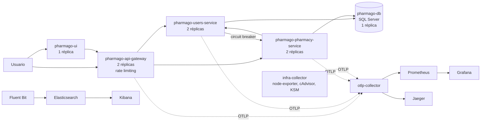
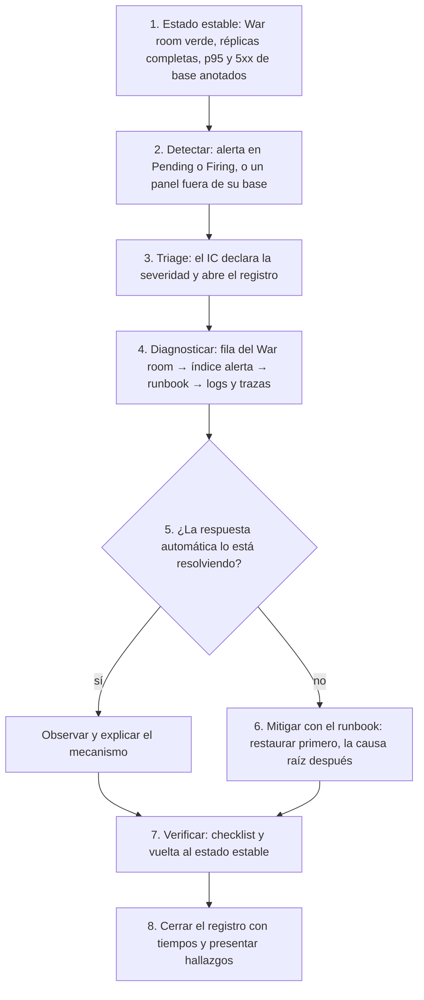

# Plan de contención de incidentes operacionales — PharmaGo

Plan de mitigación de incidentes de PharmaGo sobre Kubernetes (minikube). Sigue el ciclo de
la clase 5: **Preparar → Detectar → Responder → Recuperar → Aprender**.

**Cómo se usa:**
- **Con nuestros scripts de caos** (`chaos-engineering/`): cada runbook dice qué script
  provoca su falla, así que se puede mostrar uno por uno, con la alerta, el panel y el
  mecanismo que responde.
- **Con el script de los docentes,** que no conocemos: se parte de lo que se ve. Una alerta
  en el War room o un panel fuera de su base lleva al **índice alerta → runbook** (sección 7.1),
  y de ahí al runbook.

Todos los comandos se corren desde Git Bash, en `Implementacion K8S/Codigo/`, con el
contexto `minikube`. Los tiempos que se citan son los medidos en los recorridos del equipo;
donde no hay medición, no se da un número.

---

## 1. Alcance y servicios críticos

### 1.1 Componentes y dependencias



### 1.2 Qué percibe el usuario si cae cada uno

| Componente | Réplicas | Si cae | Criticidad |
|---|---|---|---|
| `pharmago-db` | 1 (`Recreate`, volumen persistente) | Users y pharmacy responden 500 a todo lo que toca datos: login, compras, gestión | **Crítico, punto único de falla** |
| `pharmago-api-gateway` | 2 | Si caen las 2, la API entera queda inaccesible | Crítico; una réplica alcanza |
| `pharmago-users-service` | 2 | Login, usuarios, roles; pharmacy también lo llama | Crítico; una réplica alcanza |
| `pharmago-pharmacy-service` | 2 | Farmacias, drogas, compras, stock. Users corta con el circuit breaker | Crítico; una réplica alcanza |
| `pharmago-ui` | 1 | La web no carga; la API sigue funcionando | Alto |
| `otlp-collector`, `infra-collector` | 1 | El usuario no ve nada; **el equipo queda a ciegas** (sin métricas ni alertas confiables) | Alto para operar |
| Prometheus, Grafana | 1 | Sin War room ni alertas (ver 5.2) | Alto para operar |
| Elasticsearch, Kibana, Fluent Bit, Jaeger | 1 | Sin logs ni trazas; métricas y alertas siguen | Medio |

---

## 2. Mecanismos de contención

Qué limita el alcance (blast radius) de cada tipo de falla, y qué explica la defensa cuando
el sistema se recupera solo.

| Mecanismo | Qué contiene | Dónde está | Qué se ve cuando actúa |
|---|---|---|---|
| **2 réplicas** de gateway, users y pharmacy | La caída de un pod: la otra réplica atiende | `k8s/deployments/backend/*.yaml` | 0 errores al borrar un pod (30 de 30 respuestas 200; pod nuevo listo a los 8 s) |
| **Readiness** (cada 2 s, sale al primer fallo) | Un pod que no responde deja de recibir tráfico | Ídem | El pod pasa a `0/1`; "Endpoints listos por Service" baja en 1 |
| **Liveness** (cada 5 s, reinicia tras 3 fallos) | Un proceso colgado se reinicia solo | Ídem | `RESTARTS` sube; alerta "Contenedor reiniciado o reemplazado" |
| **Probes de la DB con una consulta** (`sqlcmd SELECT 1`) | SQL Server colgado: sale de Ready y, a los ~90 s, se reinicia | `k8s/deployments/ops/db-deployment.yaml` | Alerta "Base de datos no disponible" |
| **Límites de CPU** (500m por pod de la app) | Un pod que consume CPU de más: se lo frena (throttling) sin afectar al resto | `resources.limits.cpu` | El pod se queda en ~0,48 cores |
| **Límites de memoria** (384Mi) | Una fuga de memoria: OOMKill de ese contenedor y reinicio | `resources.limits.memory` | `OOMKilled` en "Última terminación por contenedor" |
| **Límites de `ephemeral-storage`** (256Mi) | Un pod que llena el disco: el kubelet lo desaloja antes de que llene el nodo | `resources.limits.ephemeral-storage` | Pod en `Completed`, reemplazo listo en ~18 s |
| **Circuit breaker** users → pharmacy (Polly) | Una cascada: si pharmacy cae, users responde 503 en milisegundos en vez de colgarse | `PharmacyResilience` en `appsettings.json` de users, más el `ConnectTimeout` de su `HttpClient` | 503 rápidos (7–9 ms) con `X-Circuit-State: open`; se cierra al volver pharmacy |
| **Retry y timeout por intento** (2 s, 3 reintentos, `ConnectTimeout` 1 s) | Fallos transitorios hacia pharmacy | Ídem | Logs `Retry scheduled ... Attempt=n` |
| **Rate limiting** en el gateway (por IP y por réplica) | Abuso o exceso de requests de un cliente | `IpRateLimiting` en `appsettings.json` del gateway | 429 en vez de saturar los servicios |
| **RollingUpdate** con `maxUnavailable: 0` | Un deploy no corta el servicio | Deployments ([despliegue-seguro.md](despliegue-seguro.md)) | 0 errores durante el rollout |

**Lo que no está contenido** (y por eso tiene runbook manual): la DB tiene una sola réplica,
la saturación del nodo no tiene a dónde moverse (un solo nodo) y el circuit breaker no cubre
pharmacy → users ni el gateway → servicios.

---

## 3. Severidades

Se asignan por **impacto en el usuario** (clase 6: "¿el usuario percibe degradación?").
Cada alerta trae su severidad en la label `severity` (Grafana → Alerting → Alert rules).
Es un punto de partida: el IC la sube o la baja en el triage según lo que se ve.

| Sev | Label | Criterio | Ejemplos | Respuesta |
|---|---|---|---|---|
| **1** | `critical` | El usuario no puede usar una función crítica: login, compras, gestión | RB10, RB12 (si cae un servicio entero), RB13 | Todo el equipo. Mitigar primero, diagnosticar después |
| **2** | `warning` | Degradación visible (lentitud, errores parciales) o estamos sin observabilidad | RB2, RB4, RB6, RB8, RB9, RB11 | IC y un responder |
| **3** | `info` | Riesgo sin impacto todavía: el sistema se está defendiendo solo | RB1, RB3, RB5, RB7 | Observar y confirmar que la respuesta automática funciona |

**Reglas para subir la severidad:**
- Una Sev 3 pasa a 2 si aparecen 5xx o sube la latencia p95.
- Cualquier incidente pasa a 1 si "Disponibilidad del gateway" baja de forma sostenida o
  un Service queda sin endpoints.

---

## 4. Roles y comunicación

### 4.1 Roles

| Rol | Hace | En la defensa |
|---|---|---|
| **Incident Commander (IC)** | Declara el incidente y la severidad, decide qué se hace, lleva el registro y la línea de tiempo, y explica a los docentes | Habla. No toca la terminal |
| **Responder de plataforma** | `kubectl`: pods, eventos, describe, escalar, borrar, rollout | Terminal |
| **Responder de telemetría** | War room, Explore, Kibana, Jaeger: encuentra la causa y confirma la recuperación | Grafana |
| **Stakeholders** | Reciben el estado | Los docentes |

- **En los ensayos, los roles rotan,** para que los tres practiquen todo.
- **En la defensa son fijos,** con la asignación que se acuerde antes. Si alguien falta, el IC
  toma también el rol de telemetría.

### 4.2 Comunicación

- **Canal único:** en la defensa, presencial. Fuera de ella, el chat del equipo.
- **El IC anuncia en voz alta cada cambio de estado:** detectado, mitigando, recuperado. Y lo
  anota en el registro (sección 8).
- **Una sola conversación:** los responders informan al IC; no se discuten hipótesis en paralelo.
- **No hay notificaciones automáticas** (contact points de Grafana): en una defensa presencial
  alcanza el dashboard. Un webhook a un chat es la mejora natural para un equipo real.

---

## 5. Preparación (Prepare)

### 5.1 Checklist antes de la defensa o de un ensayo

1. Cluster arriba: `minikube status` y `kubectl get pods -n pharmago`, todo `Running` y `1/1`.
2. Port-forwards activos. Para el caos conviene la versión que se reconecta sola, porque
   borrar un pod corta el port-forward atado a él:
   ```bash
   cd k8s && bash port-forward-watch.sh        # parar: bash port-forward-watch.sh --stop
   ```
   No se usa junto con `port-forward.sh`: pelean por los mismos puertos.
3. Grafana (http://127.0.0.1:3000) con el dashboard **PharmaGo - War room**, refresh de 5 s
   y los últimos 15 minutos.
4. Otra terminal con `kubectl get pods -n pharmago -w`.
5. Kibana (http://127.0.0.1:5601) con el data view de los logs, y Jaeger (http://127.0.0.1:16686).
6. **Estado estable anotado:** todas las alertas en Normal, réplicas completas, p95 y 5xx de
   base, "Disponibilidad del gateway" en 100 %.
7. Imágenes de los scripts ya bajadas (`minikube image pull python:3.12-alpine`,
   `alpine:3.20`, `nicolaka/netshoot:v0.13`), para no perder tiempo en la descarga.
8. Memoria de Windows: más de 2 GB disponibles. Si no, cerrar programas antes.
9. Registro de incidente vacío (sección 8) y roles asignados.

**Chequeo de salud** (antes y después de cada prueba):
```bash
kubectl get pods -n pharmago                     # todo Running y 1/1, sin pods terminados
curl -s -o /dev/null -w '%{http_code}\n' http://127.0.0.1:5000/api/roles/ping   # 200
```
Más el panel "Alertas activas" vacío.

### 5.2 Si Grafana o Prometheus están caídos

Sin ellos no hay War room ni alertas. No es un runbook aparte: se resuelve antes de seguir.

1. **Diagnóstico:** `kubectl get pods -n pharmago | grep -E 'grafana|prometheus'` y
   `kubectl describe pod -n pharmago <pod>`.
2. **Mitigación:** `kubectl rollout restart deployment/grafana -n pharmago` (o `prometheus`).
   Reiniciar corta su port-forward: relanzarlo (o esperar a `port-forward-watch.sh`).
3. **Mientras tanto,** se opera a ciegas con:
   - `kubectl get pods`, `kubectl get events -n pharmago --sort-by=.lastTimestamp`, `kubectl top pods -n pharmago`;
   - la UI de Prometheus (http://127.0.0.1:9090 → Alerts no tiene nada: las reglas viven en
     Grafana; usar Graph con las queries de los runbooks);
   - Kibana para los logs.

---

## 6. Procedimiento de respuesta (Detect → Respond → Recover)



1. **Estado estable.** Checklist de 5.1. Se anota la hora de inicio de la sesión.
2. **Detectar.** Por una alerta (panel "Alertas activas", arriba en el War room) o por un panel
   fuera de su base aunque no haya alerta: el script de los docentes puede provocar algo que
   ninguna alerta mira. En ese caso se recorren las filas del War room de arriba abajo.
3. **Triage.** El IC declara la severidad (sección 3), anota `t_detect` y asigna tareas.
4. **Diagnosticar.**
   - Índice alerta → runbook (7.1). Si saltaron varias, empezar por la de mayor severidad.
   - La fila del War room que nombra el runbook.
   - `kubectl get pods`, `kubectl describe pod`, `kubectl get events -n pharmago --sort-by=.lastTimestamp`.
   - Logs: panel "Logs Warning y Error del namespace" o Kibana. Trazas: panel "Trazas" o
     Jaeger, y de la traza a sus logs por `Scopes.TraceId`.
5. **¿Lo está resolviendo el sistema?** Cada runbook dice qué mecanismo responde solo. Si
   actúa, el equipo observa y lo explica (es lo que pide la defensa). No se interviene para no
   tapar el mecanismo.
6. **Mitigar.** Si no se resuelve solo, la mitigación manual del runbook. **Primero restaurar
   el servicio** (reiniciar, escalar, rollback, sacar el componente roto); la causa raíz va
   después, en el postmortem. Cada acción se anota con hora y quién la hizo.
7. **Verificar** (checklist de recuperación, clase 5):
   - la alerta volvió a Normal;
   - las réplicas están completas y `1/1`, sin pods terminados;
   - el panel afectado volvió a su base;
   - un login de prueba da 200;
   - si se borraron pods: los port-forwards responden.
8. **Cerrar y presentar hallazgos.** El IC cierra el registro con los tiempos (sección 8) y
   presenta un mini postmortem: qué pasó, qué lo detectó, qué mecanismo actuó, cuánto tardó
   en restaurarse y qué se mejoraría.

**Lo que no es un incidente:** un port-forward que deja de responder después de borrar o
reemplazar un pod. `port-forward-watch.sh` lo reconecta en unos segundos; con
`port-forward.sh`, relanzar con `bash port-forward.sh --stop && bash port-forward.sh`.

---

## 7. Runbooks

### 7.1 Índice alerta → runbook

| Alerta (Grafana, carpeta PharmaGo) | Severidad | Runbooks |
|---|---|---|
| Base de datos no disponible | critical | RB13 |
| Servicio de la app sin endpoints listos | critical | RB10, RB12 |
| Errores 5xx en un servicio | warning | RB9, RB13, RB12, RB2 |
| Latencia P95 elevada de la API | warning | RB2, RB12, RB3 |
| Réplicas no disponibles | warning | RB9, RB12, RB7, RB5, RB13 |
| Contenedor reiniciado o reemplazado | info | RB5, RB9, RB12, RB7 |
| Pod desalojado o fallido | warning | RB7, RB6, RB8 |
| CPU del pod cerca de su límite | info | RB3 |
| CPU elevada del nodo | warning | RB4 |
| Memoria del pod cerca de su límite | info | RB5 |
| Memoria elevada del nodo | warning | RB6 |
| Poco espacio disponible en disco | warning | RB8 |
| Rechazos elevados por rate limiting | info | RB1 |
| Errores 4xx en un servicio | warning | RB1 |
| Collector OTLP inaccesible | warning | RB11 |
| *(ninguna, pero un panel fuera de su base)* | — | Recorrer las filas del War room; 5.2 si no hay Grafana |

Formato de cada runbook: **síntoma → alerta → diagnóstico → respuesta automática →
mitigación manual → verificación**, y el script que lo simula.

### RB1 · Exceso de requests o abuso de un cliente — Sev 3

- **Síntoma:** muchos 429 en el gateway; logins legítimos rechazados durante un minuto.
- **Alertas:** "Rechazos elevados por rate limiting" (Firing a t+93 s en el recorrido del
  2026-11-16); "Errores 4xx en un servicio" si el tráfico da 4xx (Firing a t+93 s).
- **Diagnóstico:** War room → fila "Inyección de requests": "Requests/s del gateway por status
  code", "Rechazos 429 en 2 min", "4xx sin 429 en 2 min por servicio". En Kibana, los logs del
  gateway para ver la ruta. El origen (IP) no está verificado en los logs.
- **Respuesta automática:** el rate limiting del gateway rechaza con 429 lo que pasa del
  límite, por IP y **por réplica** (cada pod cuenta por separado). Los servicios de atrás
  no se saturan.
- **Mitigación manual:** si es abuso, esperar a que termine o cortar el origen. Si es tráfico
  legítimo, escalar el gateway (`kubectl scale deployment/pharmago-api-gateway --replicas=3 -n pharmago`),
  sabiendo que sube el límite efectivo.
- **Verificación:** la alerta vuelve a Normal (unos 3 min después del fin, por la ventana de 2 min).
- **Scripts:** `load-requests.sh`, `chaos-requests.sh`, `alertas/rate-limiting.sh`, `alertas/errores-api.sh`.

### RB2 · Latencia alta en la API — Sev 2

- **Síntoma:** la web anda lenta; requests de más de 1 s.
- **Alerta:** "Latencia P95 elevada de la API" (Firing a t+79 s).
- **Diagnóstico:** War room → fila "Latencia": "Latencia p95 por servicio en /api" dice qué
  servicio. Panel "Trazas" o Jaeger: la traza lenta muestra en qué span se va el tiempo
  (gateway, users, pharmacy o la DB). Mirar también CPU del pod (RB3) y de la DB.
- **Respuesta automática:** timeout de 2 s por intento y reintentos en users → pharmacy;
  si pharmacy no responde, el circuito se abre (RB9).
- **Mitigación manual:** reiniciar el deployment lento
  (`kubectl rollout restart deployment/<deploy> -n pharmago`) o escalarlo. Si empezó con un
  deploy, `kubectl rollout undo deployment/<deploy> -n pharmago`.
- **Verificación:** p95 por debajo de 1 s y la alerta en Normal (unos 3 min).
- **Script:** `alertas/latencia-api.sh`.

### RB3 · Saturación de CPU de un pod — Sev 3 (2 si sube la latencia)

- **Síntoma:** un pod consume CPU hasta su límite; puede subir la latencia.
- **Alerta:** "CPU del pod cerca de su límite" (Firing a 1 min 43 s).
- **Diagnóstico:** War room → "CPU del pod en % de su límite"; `kubectl top pods -n pharmago`.
  `kubectl exec -n pharmago <pod> -- top -b -n 1` para ver el proceso.
- **Respuesta automática:** el límite de CPU (500m) frena solo a ese pod; el resto del nodo no
  se entera. Si deja de responder, la readiness lo saca del tráfico y la otra réplica atiende.
- **Mitigación manual:** `kubectl delete pod <pod> -n pharmago`: el Deployment crea otro
  (listo en ~7 s) y la otra réplica atiende mientras tanto.
- **Verificación:** la alerta vuelve a Normal ~30 s después de borrar el pod.
- **Script:** `cpu-spike.sh` (no limpia solo: hay que borrar el pod).

### RB4 · Saturación de CPU del nodo — Sev 2

- **Síntoma:** todo el sistema se pone lento.
- **Alerta:** "CPU elevada del nodo" (Firing a t+175 s).
- **Diagnóstico:** War room → "CPU del nodo en % de la cuota de minikube" y "CPU del pod en %
  de su límite"; `kubectl top pods -n pharmago --sort-by=cpu`. Si ningún pod de pharmago
  explica el consumo, es algo fuera del namespace o del nodo (`minikube ssh "top -b -n 1"`).
- **Respuesta automática:** ninguna. Hay un solo nodo: no hay a dónde mover los pods. Los
  límites de CPU evitan que un pod de la app se lleve todo.
- **Mitigación manual:** cortar el consumidor (borrar el pod o el proceso). Si es carga
  legítima, bajar réplicas de lo que no es crítico (Kibana, Jaeger).
- **Verificación:** CPU del nodo por debajo del 85 % y la alerta en Normal.
- **Script:** `alertas/cpu-elevada.sh`.

### RB5 · Memoria de un pod cerca del límite u OOMKill — Sev 3 (2 si reinicia en loop)

- **Síntoma:** un pod sube de memoria; puede reiniciarse.
- **Alertas:** "Memoria del pod cerca de su límite" (Firing a 61 s); "Contenedor reiniciado o
  reemplazado" si hubo OOMKill.
- **Diagnóstico:** War room → "Memoria del pod en % de su límite" y "Última terminación por
  contenedor" (`OOMKilled`); `kubectl describe pod <pod> -n pharmago` → `Last State`.
- **Respuesta automática:** al pasar el límite (384Mi), el kernel mata el contenedor y el
  kubelet lo reinicia; la otra réplica atiende.
- **Mitigación manual:** si se repite (`CrashLoopBackOff`), `kubectl rollout undo` si vino con
  un deploy; si es carga real, subir el límite en el manifiesto.
- **Verificación:** memoria estable, sin reinicios nuevos durante 2 minutos.
- **Script:** `ram-spike.sh` (se limpia solo).

### RB6 · Memoria del nodo alta — Sev 2

- **Síntoma:** todo se pone lento; pueden aparecer desalojos u OOMKills en varios pods.
- **Alerta:** "Memoria elevada del nodo" (Firing a t+90 s).
- **Diagnóstico:** War room → "Memoria del nodo en % del límite de minikube";
  `kubectl top pods -n pharmago --sort-by=memory`.
- **Respuesta automática:** el kubelet desaloja pods por presión de memoria (sin verificar en
  minikube).
- **Mitigación manual:** como RB4, con memoria: cortar el consumidor; bajar réplicas de lo que
  no es crítico.
- **Verificación:** memoria del nodo por debajo del 85 % y la alerta en Normal (~27 s).
- **Script:** `alertas/memoria-elevada.sh` (reserva ~2,7 GB de la VM de WSL: medir la memoria
  de Windows antes).

### RB7 · Disco efímero de un pod lleno — Sev 3

- **Síntoma:** un pod desaparece y aparece otro; el viejo queda en `Completed`.
- **Alertas:** "Pod desalojado o fallido" (Firing a 30 s), "Réplicas no disponibles" y
  "Contenedor reiniciado o reemplazado".
- **Diagnóstico:** War room → "Disco efímero por pod (límite 256Mi)" y "Pods terminados";
  `kubectl get events -n pharmago --field-selector reason=Evicted`.
- **Respuesta automática:** al pasar 256Mi el kubelet desaloja el pod (~10 s) y el Deployment
  lo reemplaza (listo en ~18 s); la otra réplica atiende sin corte.
- **Mitigación manual:** borrar el pod terminado, que mantiene la alerta encendida:
  `kubectl delete pod --field-selector=status.phase!=Running,status.phase!=Pending -n pharmago`.
  Después, buscar qué escribía (logs, `/tmp`).
- **Verificación:** la alerta vuelve a Normal ~28 s después de borrar el pod.
- **Script:** `volume-spike.sh` (sin argumentos, 300 MB, provoca el desalojo).

### RB8 · Disco del nodo lleno — Sev 2

- **Síntoma:** pods que no arrancan o desalojos; errores de escritura.
- **Alerta:** "Poco espacio disponible en disco" (Firing a t+79 s).
- **Diagnóstico:** War room → "Disco disponible del nodo"; `minikube ssh "df -h"`.
- **Respuesta automática:** el kubelet desaloja pods y borra imágenes sin uso por presión de
  disco (sin verificar en minikube).
- **Mitigación manual:** liberar espacio: `minikube ssh "sudo crictl rmi --prune"`, archivos
  temporales, índices viejos de Elasticsearch.
- **Verificación:** más del 15 % libre y la alerta en Normal.
- **Script:** `alertas/disco-bajo.sh`.

### RB9 · Caída de pharmacy (o de un servicio de atrás) — Sev 2

- **Síntoma:** errores en farmacias, compras y stock; lo de users sigue andando.
- **Alertas:** "Errores 5xx en un servicio", "Réplicas no disponibles", "Contenedor reiniciado
  o reemplazado".
- **Diagnóstico:** War room → fila "Desconexión de componentes": "Endpoints listos por
  Service", "Contenedores iniciados hace menos de 2 min". En Kibana,
  `Category : "PharmaGo.Resilience.PharmacyServiceClient"` muestra los reintentos y el estado
  del circuito. `curl -i http://127.0.0.1:5000/api/roles/pharmacy-status` → header
  `X-Circuit-State`.
- **Respuesta automática:** el Deployment recrea los pods. En users, el circuit breaker se abre
  tras 5 fallos y responde 503 en 7–9 ms en vez de colgarse 2 s por intento; a los 30 s prueba
  (half-open) y se cierra cuando pharmacy vuelve. `circuit-breaker.sh` dio PASS en 16 a 42 s.
- **Mitigación manual:** normalmente ninguna. Si los pods no vuelven, `kubectl describe pod` y
  los eventos (imagen, probes, recursos).
- **Verificación:** circuito `closed`, `pharmacy-status` da 200 y las réplicas están completas.
- **Script:** `circuit-breaker.sh`.

### RB10 · Un Service sin endpoints — Sev 1

- **Síntoma:** todo lo de un servicio da error (502/503 en el gateway), aunque los pods estén
  `Running`.
- **Alerta:** "Servicio de la app sin endpoints listos" (Firing a t+54 s).
- **Diagnóstico:** War room → "Endpoints listos por Service" en 0.
  `kubectl get endpoints -n pharmago`, `kubectl describe svc <svc> -n pharmago` (el
  selector), `kubectl get pods -n pharmago --show-labels`. Si los pods existen pero no están
  Ready, ir a sus probes y logs.
- **Respuesta automática:** ninguna si el problema es el Service o su selector. Si son los pods,
  los recrea el Deployment.
- **Mitigación manual:** restaurar el selector (`kubectl apply -f k8s/services/backend/<svc>.yaml`;
  si fue `servicio-inaccesible.sh`, `bash servicio-inaccesible.sh --restore`) o
  los pods (`kubectl rollout restart deployment/<deploy> -n pharmago`).
- **Verificación:** endpoints en 2 y la alerta en Normal (~34 s).
- **Script:** `alertas/servicio-inaccesible.sh`.

### RB11 · Pérdida de observabilidad (collector caído) — Sev 2

- **Síntoma:** paneles vacíos o congelados; alertas de infraestructura en NoData.
- **Alerta:** "Collector OTLP inaccesible" (Firing a t+45 s).
- **Diagnóstico:** War room → "Scrapes de Prometheus (up)": `otlp-collector` e `infra-otlp`
  en 0. `kubectl get deploy otlp-collector infra-collector -n pharmago`.
- **Respuesta automática:** el Deployment recrea el pod si muere. No lo hace si lo escalaron a 0.
- **Mitigación manual:** `kubectl scale deployment/otlp-collector --replicas=1 -n pharmago` o
  `kubectl rollout restart deployment/otlp-collector -n pharmago`. **Mientras tanto se
  diagnostica con `kubectl` y Kibana** (los logs no pasan por el collector).
- **Verificación:** `up` en 1 y la alerta en Normal (~23 s). Al volver puede saltar un rato
  "Contenedor reiniciado o reemplazado" y "Memoria del pod cerca de su límite" del
  infra-collector, que acumuló reintentos: es esperable.
- **Script:** `alertas/collector-inaccesible.sh`.

### RB12 · Interrupción de red — Sev 2 (1 si cae un servicio entero)

- **Síntoma:** un pod (o un servicio) deja de responder aunque el proceso esté vivo; timeouts.
- **Alertas:** "Réplicas no disponibles" (Firing a ~t+32 s) y "Contenedor reiniciado o
  reemplazado" (~t+42 s): la liveness falla por red y reinicia el contenedor (~t+18 s), pero
  la regla de red sigue. Con un solo pod cortado no hay 5xx: la otra réplica atiende (corrida
  del 2026-11-16, `loss` de 60 s en un pod de pharmacy). Con todo un servicio cortado se
  sumarían "Servicio de la app sin endpoints listos" y "Errores 5xx en un servicio" (sin
  verificar).
- **Diagnóstico:** War room → fila "Interrupción de red": "Red recibida por pod" y "Red
  enviada por pod" caen a ~0 en ese pod; "Endpoints listos por Service" baja. El pod está
  `Running` pero `0/1`, con reinicios. `kubectl describe pod` muestra las probes con timeout.
  Para ver una regla de red: `kubectl debug -n pharmago <pod> --profile=netadmin
  --image=nicolaka/netshoot:v0.13 -- tc qdisc show dev eth0`.
- **Respuesta automática:** la readiness saca al pod del tráfico en segundos (salió de Ready a
  ~t+5 s) y la otra réplica atiende. La liveness reinicia el contenedor, pero eso no arregla la
  red: la regla vive en el namespace de red del pod, que sobrevive al reinicio.
- **Mitigación manual:** borrar el pod (`kubectl delete pod <pod> -n pharmago`): el reemplazo
  sale con red nueva. Si el corte es en todo el servicio, borrar los pods de a uno. Si fue
  nuestro script, `bash network-chaos.sh --restore <pod>` borra la regla.
- **Verificación:** el pod `1/1` (volvió ~6 s después de borrar la regla), tráfico de red
  normal, alertas en Normal.
- **Script:** `chaos-engineering/network-chaos.sh` (`loss` corta la red de un pod de pharmacy;
  `delay` la degrada).

### RB13 · Caída o cuelgue de la base de datos — Sev 1

- **Síntoma:** login, compras y gestión dan 500 (o tardan y dan 500). La UI carga, pero no
  hay datos.
- **Alertas:** "Base de datos no disponible" y "Errores 5xx en un servicio"; si se reinicia,
  "Réplicas no disponibles" y "Contenedor reiniciado o reemplazado" de `pharmago-db`.
- **Tiempos medidos** (2026-11-16, SQL Server congelado con `kill -STOP`):

  | Momento | Desde el congelamiento |
  |---|---|
  | Un login responde 500 | a los 36 s (espera el timeout de la consulta) |
  | La DB sale de Ready | t+24 s |
  | "Base de datos no disponible" Pending / Firing | t+41 s / **t+64 s** |
  | "Errores 5xx en un servicio" Firing (7 logins fallidos) | t+115 s |
  | La liveness la marca para reiniciar / el contenedor vuelve a arrancar | ~t+70 s / t+100 s |
  | La DB vuelve a Ready | t+134 s |
  | La alerta vuelve a Normal; el login da 200 | t+161 s |
- **Diagnóstico:**
  - War room → "Endpoints listos por Service": `pharmago-db` en 0.
  - `kubectl get pod -n pharmago -l app=pharmago-db` y `kubectl describe pod` (probes con
    timeout, reinicios).
  - Kibana: los 500 de users y pharmacy quedan logueados con la excepción (`SqlException`) y
    su `Scopes.TraceId`; buscar `LogLevel : "Error"`. La categoría es el `ExceptionFilter` del
    servicio, o `Microsoft.AspNetCore.Server.Kestrel` cuando la consulta falla al armar la
    respuesta (por ejemplo `GET /api/drug`).
  - Probar la DB a mano:
    `kubectl exec -n pharmago deploy/pharmago-db -- sh -c 'exec /opt/mssql-tools18/bin/sqlcmd -C -S localhost -U sa -P "$SA_PASSWORD" -Q "SELECT 1" -b -l 3'`.
- **Respuesta automática:** las probes de la DB ejecutan una consulta. Si no responde, la
  readiness la saca de Ready (~30 s) y la alerta salta; si sigue colgada ~90 s, la liveness
  reinicia el contenedor. Los datos están en un volumen persistente y sobreviven al reinicio.
  **No hay réplica:** mientras tanto users y pharmacy siguen Ready y responden 500 (su
  `/health` no mira la DB, a propósito: si lo hiciera, la caída de la DB tiraría también a
  los servicios).
- **Mitigación manual:** si no se recupera sola, `kubectl delete pod -n pharmago -l app=pharmago-db`
  (estrategia `Recreate`: hay un corte hasta que el nuevo arranca). Si el pod no arranca,
  `kubectl describe pod` y los eventos (el volumen, la memoria).
- **Verificación:** la DB `1/1`, un login da 200, la alerta en Normal.
- **Script:** ninguno de caos. Se simula con `kubectl delete pod` de la DB, o congelando
  SQL Server (el motor es el hijo del PID 1, el watchdog; su PID cambia en cada arranque):
  ```bash
  kubectl exec -n pharmago deploy/pharmago-db -- sh -c 'kill -STOP $(ps -o pid= --ppid 1)'
  kubectl exec -n pharmago deploy/pharmago-db -- sh -c 'kill -CONT $(ps -o pid= --ppid 1)'   # descongelar
  ```

---

## 8. Registro de incidente y métricas

### 8.1 Registro (template de la clase 5, con tiempos)

```
Incidente #      · Severidad:      · IC:
Inicio (t_start):            Detección (t_detect, alerta o panel):        Ack (t_ack):
Mitigación aplicada (t_repair):            Servicio restaurado (t_restore):
Descripción / síntoma:
Servicios afectados:
Runbook usado:
Acciones tomadas (hora — quién — qué):
Mecanismo automático que actuó:
```

### 8.2 Métricas

Definiciones de la clase 1:
- **MTTD** (detección) = t_detect − t_start;
- **MTTA** (reconocimiento) = t_ack − t_start;
- **MTTRepair** = t_repair − t_start;
- **MTTRestore** = t_restore − t_start.

De dónde sale cada tiempo:
- **t_start:** en los ensayos, la hora de arranque del script; en la defensa, el primer cambio
  en un panel (el War room tiene resolución de 5 s).
- **t_detect:** el historial de estado de la alerta en Grafana (Alerting → la regla → History),
  o la hora en que el equipo vio el panel.
- **t_restore:** cuando el panel vuelve a su base o la alerta a Normal.

**Línea de base medida** (recorridos del 2026-11-14 al 2026-11-16):

| Falla | Detección (Firing) | Restauración |
|---|---|---|
| Caída de un pod de users | "Réplicas no disponibles" a 17 s | Pod nuevo listo a los 8 s, sin errores para el usuario |
| Pod desalojado por disco | "Pod desalojado o fallido" a 30 s | Reemplazo listo ~18 s después del desalojo, sin errores |
| Caída de pharmacy | "Errores 5xx en un servicio" | Circuito cerrado y PASS en 16–42 s |
| Service sin endpoints | t+54 s | 34 s después de restaurar el selector |
| Collector caído | t+45 s | 23 s después de volver |
| SQL Server colgado | "Base de datos no disponible" a t+64 s | La liveness la reinicia; Ready a t+134 s, alerta en Normal a t+161 s |
| Red cortada en un pod de pharmacy | "Réplicas no disponibles" a ~t+32 s | Sin errores para el usuario (la otra réplica); el pod vuelve ~6 s después de quitar la regla |

---

## 9. Postmortem (Learn)

Sin culpa: se buscan causas en el sistema, no en personas.

### 9.1 Template

```
Título:                                  Fecha:            Severidad:
Resumen (2–3 líneas):
Impacto: qué vio el usuario, cuánto tiempo, qué servicios.
Línea de tiempo: t_start, t_detect, t_ack, t_repair, t_restore, con las acciones.
Causa raíz:
Qué funcionó (detección y mecanismos):
Qué no funcionó:
Acciones correctivas (qué, quién, para cuándo):
```

### 9.2 Ejemplo: el circuito tardaba ~3 minutos en cerrarse (2026-11-15)

- **Resumen:** en un ensayo de caída de pharmacy, los pods volvieron en ~20 s, pero users
  siguió respondiendo 503 durante unos 3 minutos.
- **Impacto:** las funciones de users que consultan pharmacy fallaron ~3 min en vez de ~30 s.
  El resto de la API siguió funcionando.
- **Línea de tiempo:** se borraron los pods de pharmacy; el circuito se abrió (esperado); los
  pods nuevos estuvieron listos a los ~20 s; los intentos half-open siguieron cortando por
  timeout de 2 s durante ~3 min, sin llegar a pharmacy (Jaeger no mostraba el span del
  servidor); `circuit-breaker.sh` dio FAIL.
- **Causa raíz:** el `HttpClient` de users no tenía `ConnectTimeout`. Una conexión a la IP de
  un pod borrado reintenta el SYN durante ~127 s (`tcp_syn_retries=6`), y los pedidos
  siguientes quedaban esperando esa conexión.
- **Qué funcionó:** el circuit breaker evitó la cascada (503 rápidos); las trazas mostraron que
  el pedido no llegaba a pharmacy.
- **Qué no funcionó:** la recuperación dependía de un timeout del sistema operativo.
- **Acción correctiva (hecha):** `SocketsHttpHandler` con `ConnectTimeout` de 1 s, contado como
  fallo transitorio por el retry y el circuit breaker. Verificado: 4 corridas con PASS en 16 a
  41 s.

---

## 10. SLOs

| SLI | SLO | Dónde se mide | Alerta relacionada |
|---|---|---|---|
| Disponibilidad: % de respuestas del gateway que no son 5xx | ≥ 99 % | War room → "Disponibilidad del gateway" | "Errores 5xx en un servicio" |
| Latencia: p95 de `/api` por servicio | < 1 s | War room → "Latencia p95 por servicio en /api" | "Latencia P95 elevada de la API" |
| MTTRestore de los fallos que el sistema cura solo (caída de un pod, desalojo, caída de pharmacy) | Segundos, sin errores visibles para el usuario donde hay 2 réplicas | Registro de incidente (sección 8) | Las de cada runbook |

Las alertas de la app avisan antes de romper el SLO: miran ventanas de 2 minutos, y el SLO se
evalúa sobre el período de la sesión. La DB queda fuera del SLO de "segundos": con una réplica,
su caída es un corte hasta que el pod se reinicia (RB13).

**Riesgos conocidos:**
- La liveness de la DB con `sqlcmd` podría reiniciarla bajo una carga muy alta (tolera ~90 s
  sin respuesta). No se probó bajo carga.
- El rate limiting cuenta por réplica: con 2 réplicas el límite efectivo es el doble.
- `kubectl debug` (RB12) deja contenedores efímeros terminados en el pod; se van con el pod.
